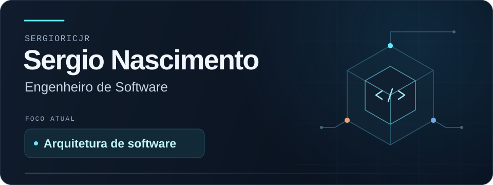

<picture>
  <source media="(max-width: 600px)" srcset="assets/profile-mobile.svg">
  
</picture>

Sou **engenheiro de software**, com foco em **arquitetura de software** e na construção de sistemas confiáveis.

### Tecnologias e ferramentas

| Área | Tecnologias |
| :--- | :--- |
| Backend e APIs | Rust · Python |
| Bancos de dados | PostgreSQL · MongoDB · Redis · Cassandra |
| Containers e cloud | AWS · Docker · MGC (Magalu Cloud) |
| Observabilidade | Grafana · Prometheus · Loki · Tempo · OpenTelemetry · Datadog |
| Interfaces | React · TypeScript · Vite · Tailwind CSS |

---

[LinkedIn](https://www.linkedin.com/in/sergio-nascimento-260918223/) · [E-mail](mailto:sergioricjr7@gmail.com)
